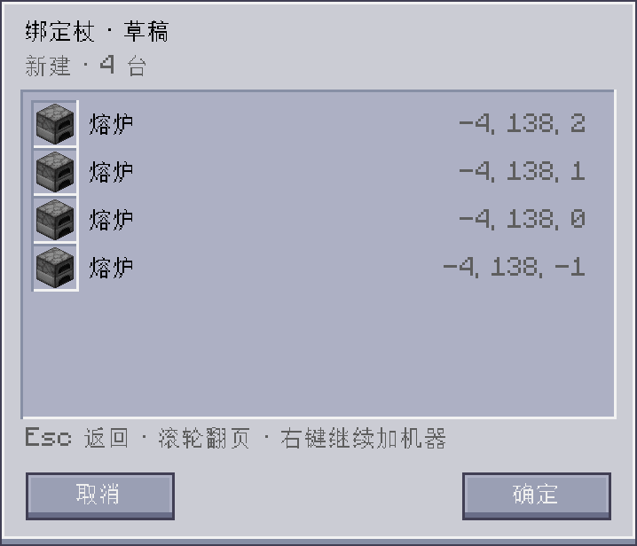
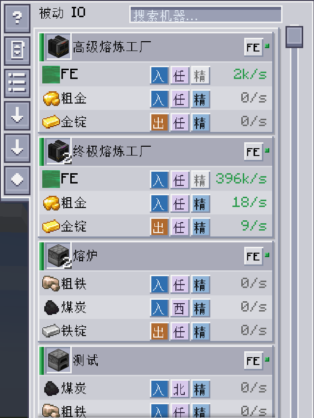

# AE2 Void Factory

**AE2 附属 · Minecraft 1.21.1 · NeoForge · 0.1.0-beta**

假如你的 AE 工厂不需要输入输出总线，也不需要一排样板供应器——拿绑定杖点一下机器，回终端里写清楚送什么、取什么，剩下的每 tick 交给它。

配方、能量、机器速度一律不动。它只负责搬东西。

## 三步把机器接进来

1. **绑定杖**：右键机器接入或断开；蹲下右键确认一批改动；同类型机器可连锁接入。
2. **节点终端**：一个节点管一台或一类机器——改名、开关阻挡、切倍率、选派单方式。
3. **写规则**：每条规则一句话——方向（入 / 出）、匹配（任 / 精）、面、速率；配好以后每 tick 自动搬运。



## 主动合成：样板广告给 CPU

给节点写样板，它把样板广告给 AE2 的 CPU；CPU 下单后输入被推进机器，产物自动扫回网络。倍率按机器能容纳的量算上限，不会把机器塞爆。

## 被动搬运：规则就是一行字

机器多了按名字搜，也能从仓库里把资源拖进规则栏直接建规则。精确匹配看物品组件，模糊匹配只看物品本身。



## 这套东西的边界

- **仓库就是你的 ME 网络**，没有第二份库存；离线表现为没料，恢复后继续；
- **速率上限 = 机器这一 tick 能收多少**，不会溢出；
- **面配错会直接告诉你**，不静默换面；
- **机器失联**（被拆、区块未加载）只在 HUD 提示，规则不丢，终端里能定位坐标。

## 安装

需要 **Applied Energistics 2**（19.2.10 或更新，开发基于 19.2.20）。把 jar 放进 `mods/` 即可。

可选：

- **Applied Flux**：没有它就没有 FE 这一类资源，装了才能给机器送电 / 取电；
- **JEI**：装了可以在 JEI 里直接看机器属于哪个节点、拖拽资源建规则。

## 开发

```bash
./gradlew build
```

产物在 `build/libs/ae2vf-<版本>.jar`。发布流程见 [docs/publish/README.md](docs/publish/README.md)。

## 许可证

MIT，见 [LICENSE](LICENSE)。
