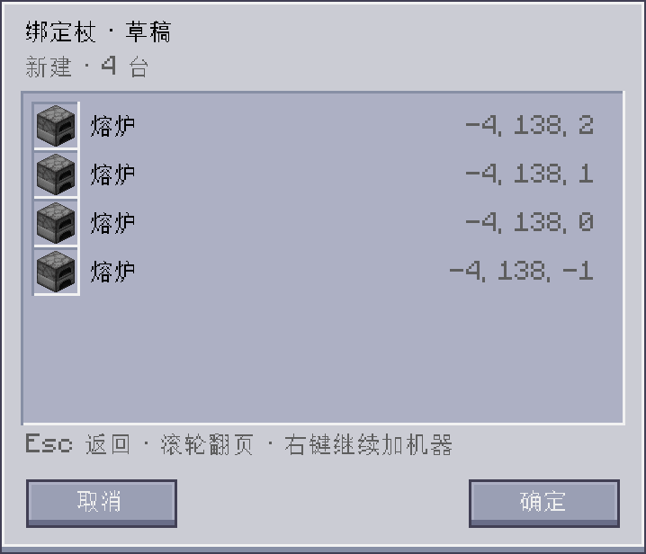
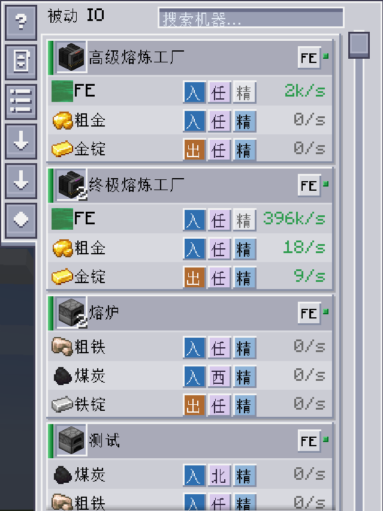
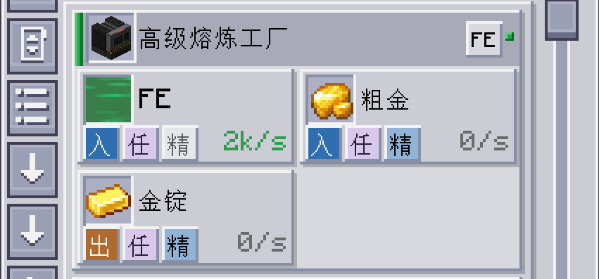
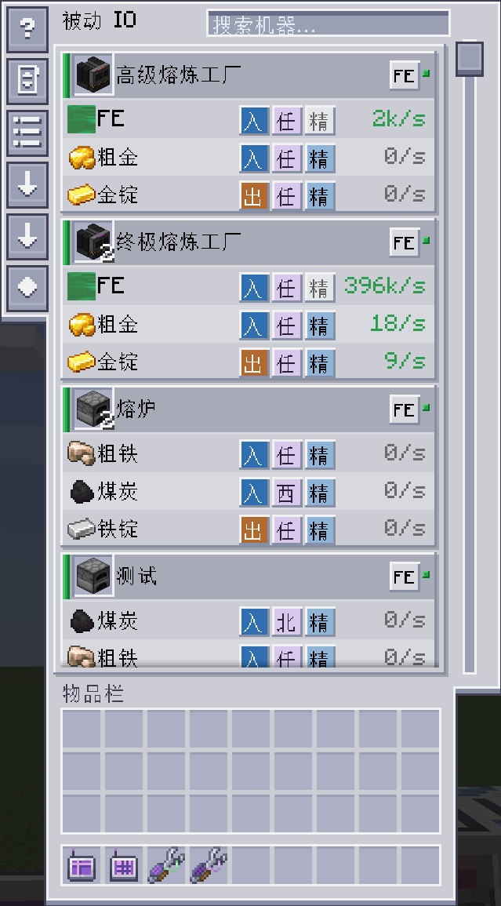

# AE2 Void Factory

**What if your AE factory needed no IO buses and no row of pattern providers?**

Tap a machine with a wand, write down what goes in and what comes out in a terminal, and let the transfer run every tick. Recipes, energy and machine speed stay untouched.

AE2 Void Factory is an **addon for Applied Energistics 2**. It only moves resources between machines and your ME network — it never guesses recipes and never takes over a machine.

## Connect a machine in three steps

1. **Wand**: right-click to connect or disconnect; sneak-right-click to commit a batch of changes; chain-bind a row of identical machines.
2. **Node terminal**: one node owns one machine or a whole group — rename it, toggle blocking, switch the multiplier, pick how jobs are dispatched.
3. **Rules in the terminal**: once a rule is live the transfer runs every tick, with the rate shown right on the card.

<!-- Image 1: wand draft dialog (4 machines, coordinates, confirm / cancel) -->

## On-demand crafting: advertise patterns to your CPU

Write patterns into a node and it advertises them to your AE2 CPUs. When a job is dispatched, inputs are pushed into the machine and the results are swept back into the network — no extra pattern providers and no return chests.

The multiplier is capped by what the machine can hold, so it never floods a machine.

<!-- Image 2: CPU dispatch / crafting view -->

## Passive transfer: one rule is one line

Every rule answers four things: **direction** (in / out), **match mode** (any / exact), **face**, and **current rate**.

- Search machines by name once the list gets long;
- Drag a resource from the network straight into a rule to create it;
- Exact matching compares item components, fuzzy matching only the item itself;
- Set up raw iron, coal and iron ingots once, and the furnaces keep running.

<!-- Image 3: passive IO list view (machine rows with their rules) -->

<!-- Image 4: card view with a full rule card -->

## Where the edges are

- **The warehouse is your ME network.** There is no second inventory; an offline network simply means "no material" and resumes when it is back.
- **The rate is capped by what the machine accepts this tick** — nothing is forced into a full machine.
- **A wrong face is reported**, never silently swapped for another one.
- **Lost machines** (broken, or in unloaded chunks) only produce a HUD notice; rules are kept, and the terminal shows the exact coordinates.
- **Mismatched machines are recognised**: a block that is not the expected machine never takes part in transfers.

<!-- Image 5: full terminal UI -->

<!-- Image 6: yellow highlight in the world while holding the wand -->
<!-- 待补：世界高亮截图（01-wand.png）到位后取消注释 -->
<!--  -->

## Installation

| | |
|---|---|
| Minecraft | 1.21.1 |
| Loader | NeoForge 21.1.x |
| Required | **Applied Energistics 2** (19.2.10 or newer) |
| Optional | **Applied Flux** for FE as a resource type; **JEI** to locate nodes from recipes and drag resources into rules |

Drop the jar into `mods/`. The mod will not start without AE2. Without Applied Flux there is simply no FE resource type — that is not an error.

## Version status

This is **0.1.0-beta**: functional, but APIs and balance may still change. If you hit transfer oddities, layout glitches or crashes, please report them with `logs/latest.log`.

## Links

- Issues: <https://github.com/crafteve/ae2vf/issues>
- Source: <https://github.com/crafteve/ae2vf>

## License

MIT.