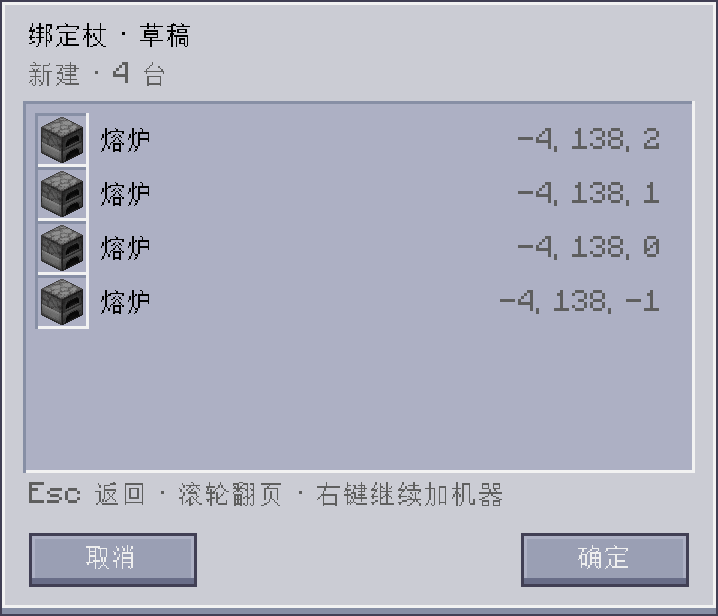
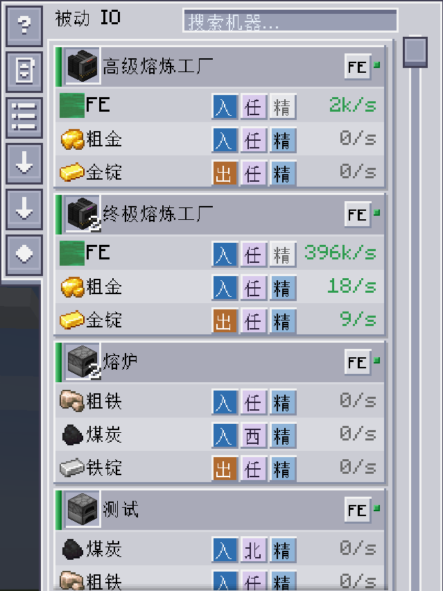
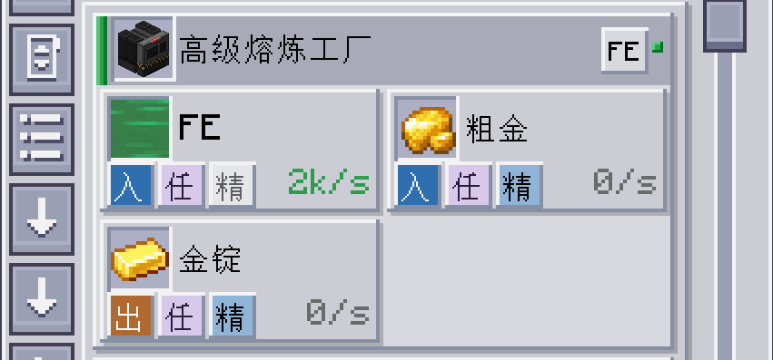
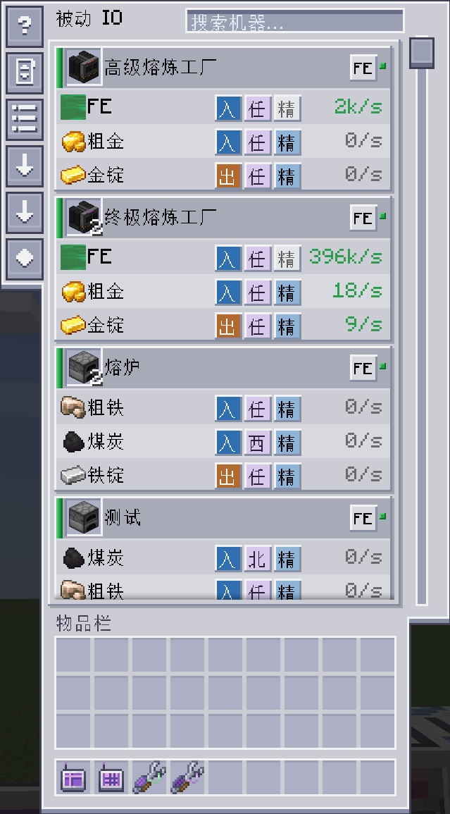

# AE2 虚空工厂

**假如你的 AE 工厂不需要输入输出总线，也不需要一排样板供应器。**

拿绑定杖点一下机器，回终端里写清楚送什么、取什么，剩下的搬运每 tick 交给它。配方、能量、机器速度一律不动。

AE2 虚空工厂是 **Applied Energistics 2 的附属**，只负责机器和 ME 网络之间的搬运，不猜配方，也不接管机器。

## 三步把机器接进来

1. **绑定杖**：右键机器接入或断开；蹲下右键确认一批改动；同类型机器可以连锁接入。
2. **节点终端**：一个节点管一台或一类机器——改名、开关阻挡、切倍率、选派单方式都在这里。
3. **终端里写规则**：规则生效后每 tick 自动搬运，速率实时显示在卡片上。

<!-- 图 1：绑定杖·草稿提交界面（新建 4 台 + 坐标 + 确定/取消） -->

## 主动合成：把样板广告给 CPU

给节点写样板，它会把样板广告给 AE2 的 CPU。CPU 下单后，原料被推进机器，产物自动扫回网络，不需要额外铺样板供应器和回收入口。

倍率按机器能容纳的量计算上限，不会把机器塞爆。

<!-- 图 2：CPU 派单 / 主动合成界面 -->

## 被动搬运：一条规则就是一行字

每条规则只回答四件事：**方向**（入 / 出）、**匹配**（任 / 精）、**面**、**当前速率**。

- 机器多了按名字搜；
- 也可以从仓库里把资源拖进规则栏直接建规则；
- 精确匹配看物品组件，模糊匹配只看物品本身；
- 配好烧结铁矿、粗铁、煤炭之后，熔炉就会自己烧。

<!-- 图 3：被动 IO 列表视图（机器行 + 规则行） -->

<!-- 图 4：卡片视图（一台机器的完整规则卡） -->

## 这套东西的边界

- **仓库就是你的 ME 网络**，不存在第二份库存；网络离线表现为"没料"，恢复后自动继续。
- **速率上限 = 机器这一 tick 能收多少**，不会把东西硬塞进去。
- **面配错会直接告诉你**，不会静默换成别的面。
- **机器失联**（被拆掉、区块没加载）只在 HUD 提示，规则不会丢；放回原位就恢复，终端里能看到具体坐标。
- **放错机器会被认出来**：类型、容器对不上的机器不会参与搬运。

<!-- 图 5：整体 UI（标题、工具栏、列表、物品栏） -->

<!-- 图 6：世界里的黄色高亮（绑定杖指向机器时） -->
<!-- 待补：世界高亮截图（01-wand.png）到位后取消注释 -->
<!--  -->

## 安装

| 项目 | 要求 |
|---|---|
| Minecraft | 1.21.1 |
| 加载器 | NeoForge 21.1.x |
| 必需 | **Applied Energistics 2**（19.2.10 或更新）|
| 可选 | **Applied Flux**：提供 FE 这一类资源；**JEI**：在配方里定位节点、拖拽建规则 |

把 jar 放进 `mods/`。没有 AE2 不会启动；没装 Applied Flux 只是没有 FE 这类资源，不是报错。

## 版本状态

当前是 **0.1.0-beta**：功能可用，接口与平衡还会调整。遇到搬运异常、界面错位或崩溃，请带 `logs/latest.log` 反馈。

## 反馈

- 问题与建议：<https://github.com/crafteve/ae2vf/issues>
- 源码：<https://github.com/crafteve/ae2vf>

## 许可

MIT。