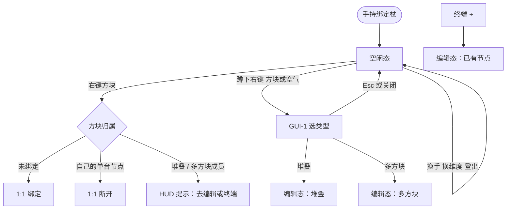
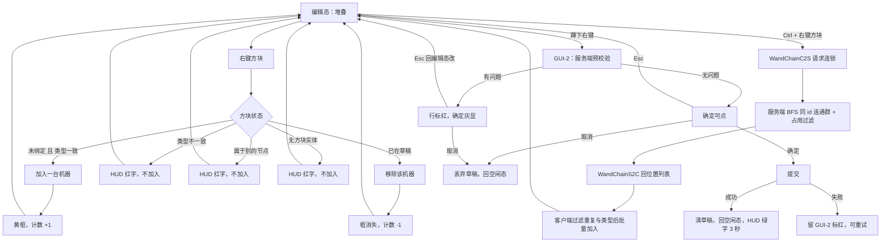
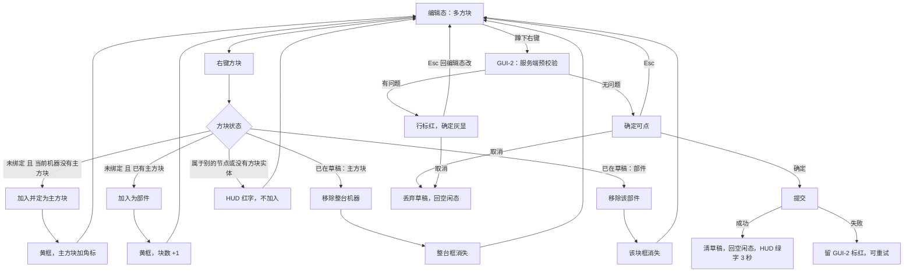
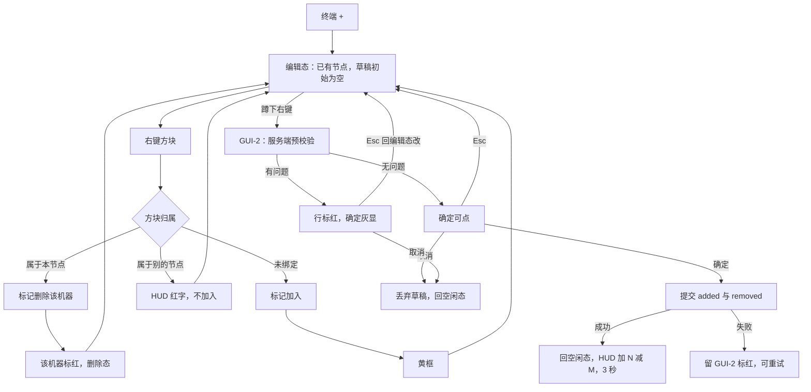
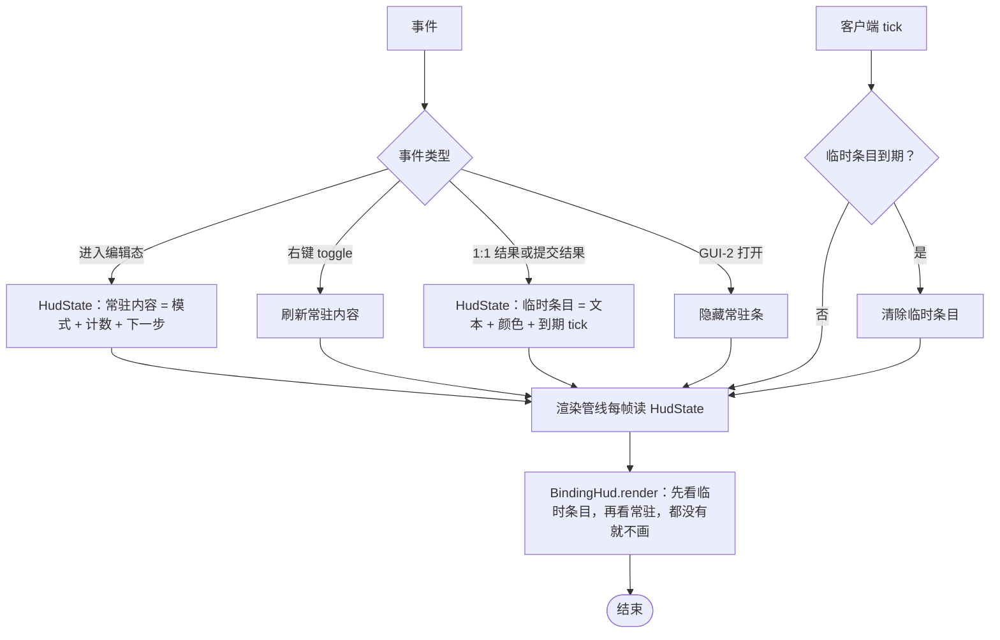
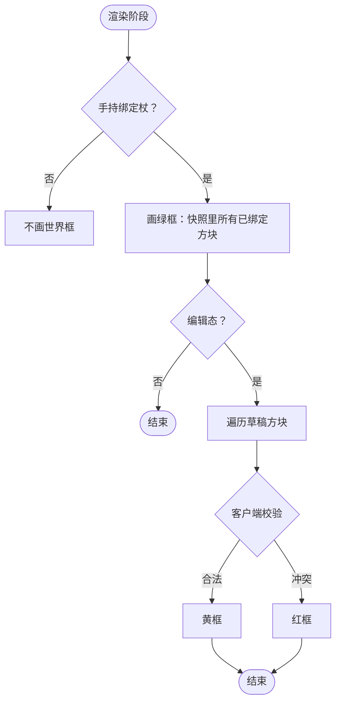
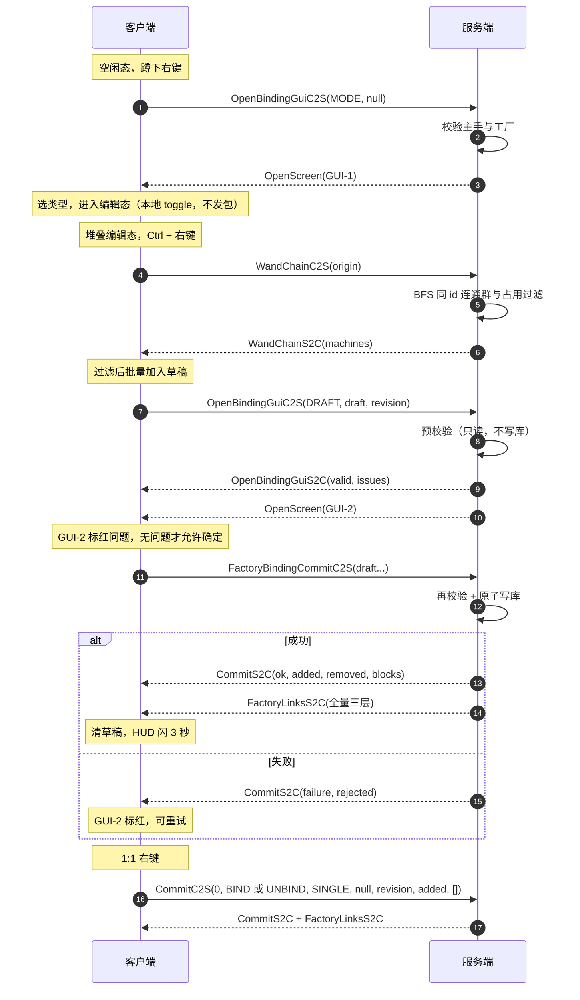

# 16-绑定杖操作逻辑

> 状态：**讨论中**（2026-11-10）：逻辑已齐，等流程图核对后再定稿。实现计划见 [机器绑定杖重构计划](../机器绑定杖重构计划.md)。
> 最后更新：2026-11-10
> 目标：只定绑定杖的**操作逻辑**（手势、状态、两个 GUI、HUD、反馈层级）。渲染细节与发包确认后再单独讨论，本文不写。

## 一、手势总表（定稿）

状态命名：**空闲态（IDLE）/ 编辑态（EDITING）**。

| 状态 | 输入 | 行为 |
|---|---|---|
| 空闲态 | 普通右键方块 | 1:1 绑定 / 断开 toggle |
| 空闲态 | 普通左键 | 不拦截、不监听（正常挖方块） |
| 空闲态 | 蹲下右键（空气或方块） | 打开 GUI-1「新建类型」 |
| 空闲态 | 蹲下滚轮 | 无操作 |
| 编辑态 | 右键方块 | 草稿 toggle：不在草稿里就加入，已在草稿里就移除 |
| 编辑态（堆叠） | Ctrl + 右键方块 | 连锁加入附近同 id 机器（服务端计算后回列表） |
| 编辑态 | 左键 | 不拦截、不监听 |
| 编辑态 | 蹲下右键（空气或方块） | 打开 GUI-2「草稿确认」 |
| 编辑态 | 蹲下滚轮 | 无操作 |
| GUI-1 | 1 / 2 / 点击 | 选类型（堆叠 / 多方块） |
| GUI-1 | Esc / 关闭 | 回 IDLE |
| GUI-2 | 确定 | 提交；失败后仍可点，允许重试 |
| GUI-2 | 取消 | 丢弃草稿并退出 |
| GUI-2 | Esc / 关闭 | 回编辑态，草稿保留 |

关键点：
- 蹲下右键**方块与空气完全等价**，方块不参与判断、**不自动加入草稿**。
- **编辑已有节点只走终端 `+`**；世界里没有「蹲下右键成员进编辑」。
- 左键在世界里**完全不拦**，IDLE 与编辑态一致。

## 二、状态机

```
空闲态（手持绑定杖，草稿空）
 ├─ 普通右键方块 ──► 1:1 绑定 / 断开（toggle）
 └─ 蹲下右键（空气或方块）──► GUI-1
                       ├─ 选类型 ──► 编辑态
                       └─ Esc / 关闭 ──► 空闲态

编辑态（草稿开放，HUD 常驻）
 ├─ 右键方块 ──► toggle
 ├─ 蹲下右键（空气或方块）──► GUI-2（打开时先校验）
 │                    ├─ 确定 ──► 提交中（按钮灰显）
 │                    │            ├─ 成功 ──► 关闭 GUI-2，HUD 绿字 + 音效 ──► 空闲态
 │                    │            └─ 失败 ──► 留在 GUI-2，失败行标红 + 原因
 │                    ├─ 取消 ──► 丢弃草稿 ──► 空闲态
 │                    └─ Esc / 关闭 ──► 回编辑态，草稿保留
 └─ 换手 / 换维度 / 登出 / 打开别的界面 ──► 空闲态（草稿丢弃）
```

## 三、toggle 规则（定稿）

| 情况 | 行为 |
|---|---|
| 方块不在草稿里，且可加入 | 加入（堆叠 = 加一台机器；多方块 = 加一个方块） |
| 方块已在草稿里 | 移除。堆叠：删那台机器；多方块：移除主方块 = 整台机器一起删，部件只删部件 |
| 方块已属于别的节点 | **即时拒绝** + 提示，不加入 |
| 方块没有方块实体 | 即时拒绝 + 提示 |
| 堆叠模式下类型与第一台不一致 | **即时拒绝** + 提示 |
| 草稿被 toggle 到 0 台 | 保持编辑态，HUD 显示 0 台 |
| 草稿里的方块被挖掉 | 下次右键 / 打开 GUI-2 / 提交前检测到，**标红提示**，可手动移除 |

### 3.1 连锁加入（Ctrl + 右键，仅堆叠编辑态）

- **只在堆叠类编辑态生效**：新建堆叠节点、编辑已有堆叠节点。空闲态、多方块编辑态按 Ctrl+右键无操作。
- 服务端用现有 `FactoryLinkFinder.machines`：从目标方块出发 6 邻接 BFS，只穿**同方块 id**、有方块实体、且至少有一种能力（物品 / 流体 / 能量）的方块；最多 128 台、半径 32 格、访问上限 4096。
- 服务端再按占用表过滤：属于别的节点的去掉。
- 客户端收到列表后再过滤：已在草稿里的、堆叠类型不一致的、编辑已有节点时已属于本节点的，都跳过。
- 加入草稿后 HUD 闪 3 秒：`已连锁加入 8 台（跳过 3 台）`；全部被跳过时给原因。
- 连锁只是**往草稿里加**，不直接建节点；仍要蹲下右键 → 确认窗 → 确定。
- 连锁结果超过 128 台时只加前 128 台，HUD 提示「连锁上限 128 台」。

## 四、两个 GUI

### GUI-1：新建类型

```
┌──────────────────┐
│  绑定杖           │
├──────────────────┤
│  [ 堆叠机器 ]     │
│  [ 多方块机器 ]   │
├──────────────────┤
│            关闭  │
└──────────────────┘
```

- 只列两项；单台走 1:1，不出现。
- 键盘 1 / 2 直选；鼠标点也可。
- 选中即关闭并进入编辑态。

### GUI-2：草稿确认

```
┌────────────────────────────┐
│  绑定杖 · 草稿              │
├────────────────────────────┤
│  堆叠 · 3 台 · 3 块         │
│  ▣ 熔炉  (-12, 64, 8)      │
│  ▣ 熔炉  (-12, 64, 9)      │
│  ▣ 熔炉  (-12, 64, 10)     │
│  …                          │
├────────────────────────────┤
│          [ 取消 ] [ 确定 ]  │
└────────────────────────────┘
```

- 每台机器一行：图标 + 名字 + 坐标；多方块显示主方块 + 块数。
- 行纯展示，不响应点击；行数多时滚动。
- 失败时行标红 + 面板底部原因；确定按钮保持可点。
- 提交中：确定灰显，标题旁「提交中…」。

## 五、提示系统（统一 HUD，底部居中）

**所有绑定杖提示都由同一个 `BindingHud` 负责**，不再用动作栏。

### 5.1 四种形态

| 形态 | 触发 | 文案示例 | 时长 | 颜色 |
|---|---|---|---|---|
| 常驻条 | 编辑态全程 | `[堆叠] 3 台 / 3 块 · 右键加机器 · 蹲下右键确认` | 编辑态全程 | 正常 |
| 成功闪条 | 1:1 成功 / 提交成功 | `✓ 已连接 熔炉` / `✓ 已保存：+2 台 / -1 台` | 3 秒 | 绿 |
| 失败闪条 | 1:1 失败 / 提交失败 / 加块被拒 | `✗ 节点还有 3 条规则，先清空` | 3 秒 | 红 |
| 中性闪条 | 无效操作提示 | `堆叠节点成员：去终端编辑` | 3 秒 | 黄 |

### 5.2 格式

- 单行，底部居中，AE2 深底浅字；左侧状态点、中间文案、右侧按键提示。
- 常驻条左区：类型 + 台数/块数；右区：当前可用动作（`右键加机器` / `右键加部件` / `蹲下右键确认`），随状态变化。
- 数字变化滚动 0.2 秒；冲突时右区变红。
- 闪条覆盖常驻条的位置；闪条结束后恢复常驻；空闲态没有常驻条时单独显示。

### 5.3 显示逻辑

- 同一时刻最多一条闪条；新闪条直接覆盖旧的，不排队。
- 闪条用客户端 tick 计时，3 秒后自动消失。
- 文案集中在一处（`BindingMessages`），不在调用点拼字符串。
- 音效与闪条同时触发。

### 5.4 绘制方式

- **状态由事件更新**：输入事件改草稿 / 状态；网络回执设置闪条；客户端 tick 检查闪条到期。
- **渲染由管线每帧读取**：`RenderGuiLayerEvent` 每帧调 `BindingHud.render`，只读 `HudState`（常驻内容 + 临时条目），不自己判断业务。

## 六、默认项（未反对即执行）

- 空闲态没有常驻条，只在闪条时出现；编辑态常驻条全程显示。
- 编辑态里打开背包 / 终端 / 死亡传送 → 丢弃草稿（和换手同规则）。
- 不校验绑定距离（沿用 15 号「不做防作弊」）。
- 编辑态加块即时做客户端能做的校验，失败标红 + HUD 红字。
- 提交超时 5 秒：留在 GUI-2，提示「服务端未响应」，确定按钮恢复可点。
- 音效时机：进入编辑态、加入块、移除块、提交成功、提交失败。
- 新节点名字默认用方块名，之后在终端改。
- 1:1 快速断开时节点还有规则 / 样板 → 拒绝并提示去终端清空。

## 七、已否决 / 已推翻

- 轮盘形态的 GUI。
- 标签聚合数据模型（只借 SFM 的 GUI 与绑定手法）。
- 堆叠多方块本轮的绑定入口。
- 编辑态「右键加、左键删」→ 改为右键 toggle。
- 「取消保留草稿回编辑态」→ 取消 = 丢弃退出。
- 「提交失败自动关 GUI」→ 留在 GUI-2 显示错误。
- 滚轮切类型 → 改为只在 GUI-1 选。
- 主方块移除顺延 → 改为移除主方块即整台机器移除。
- 空闲态左键拦截挖掘 → 改为不拦截、不监听。
- 世界「蹲下右键成员进编辑态」→ 改为编辑只走终端 `+`。
- 蹲下右键方块自动作为第一块 → 改为与空气等价、不自动加入。

## 八、渲染（待核对）

### 已确认

- 世界内**沿用现有机器绑定杖的线框渲染**（`FactoryLinkRenderer` 的 VBO 线框），只加颜色区分。（2026-11-10）
- 三色：**绿 = 已绑定，黄 = 草稿，红 = 冲突 / 非法**。（2026-11-10）
- **不做曲线**。（2026-11-10，用户澄清：没提过曲线，渲染指的是绑定 pos 时的框）
- **不做准星悬停高亮**。（2026-11-10）
- **不做世界内提交动画**；成功 / 失败只靠 HUD + 音效。（2026-11-10）
- **绿框只手持绑定杖时显示**。（2026-11-10）
- **黄框 / 红框在编辑态一直显示**，不按距离裁剪。（2026-11-10）
- 两个 GUI：**用 AE2 外壳**——`extends AEBaseScreen` + AE2 style json（仿 `priority.json` / `craft_confirm.json` / `set_stock_amount.json`），背景与按钮用 AE2 原生贴图与控件；AE2 没有的组件（草稿行列表）才用项目自己的绘制。（2026-11-10）
- 代价：需要两个无槽位 MenuType + 两个 Menu，打开走服务端（多一个往返）。
- 待验证：style json 的 `background.texture` 能否跨命名空间引用 AE2 贴图（`ae2:guis/priority.png`）；不行就复制对话框贴图到项目资源，或复用 `base_terminal.json`。

### HUD 分模式设计

- **堆叠 HUD**：模式 + 台数/块数 + 下一步按键，单行。（2026-11-10 用户确认「1 最好」）

  ```
  [堆叠]  3 台 / 3 块 · 右键加机器 · 蹲下右键确认
  ```

- **多方块 HUD**：方案 A——核心 + 总块数 + 按键，单行。（2026-11-10）

  ```
  [多方块]  ▣ 熔炉核心 · 12 块 · 右键加部件 · 蹲下右键确认
  ```

- **HUD 固定单行**，放不下的信息进 GUI-2。（2026-11-10）

- **1:1 成功 / 失败 HUD**：闪 3 秒；成功文案带机器名，如 `✓ 已连接 熔炉`。（2026-11-10）
- **编辑提交成功 HUD**：闪 3 秒，显示增量数字，如 `✓ 已保存：+2 台 / -1 台`。（2026-11-10）
- **编辑提交失败**：闪 3 秒红字，同时留在 GUI-2 标红。

#### 多方块 HUD 落选方案

A. 核心 + 总块数 + 按键（单行）

```
[多方块]  ▣ 熔炉核心 · 12 块 · 右键加部件 · 蹲下右键确认
```

B. 核心 + 总块数 + 部件分布（两行）

```
[多方块]  ▣ 熔炉核心 · 12 块
          ▣×3  ▤×2  ⚙×7 · 右键加部件 · 蹲下右键确认
```

C. 核心 + 核心/部件分离计数（单行）

```
[多方块]  ▣ 熔炉核心（主） · 1 核心 + 11 部件 · 蹲下右键确认
```

D. 核心 + 部件图标条（单行，按加入顺序排，超出 +N）

```
[多方块]  ▣ 熔炉核心 · ▣▤⚙⚙⚙ +7 · 蹲下右键确认
```

#### 多方块 HUD 需要注意的信息

- 主方块要标出来（移除主方块 = 整台机器删除）。
- 部件种类可能很多，一行放不下时要决定「合并同类」还是「截断 +N」。
- 没有「台数」概念，只有「块数」。

## 十、发包（待核对）

### 原则

- 草稿是**客户端 UI 状态，不上网、不落盘**。编辑态期间不传；**打开 GUI-2 时传一次做预校验**，提交时再传一次做权威校验。
- **先校验、后确认**：预校验不通过 → GUI-2 标红且确定灰显；通过才允许确定。
- 预校验与提交**共用同一套校验函数**（`validate` 只读，`commit` 校验后写库）。
- 1:1 与草稿**合并成一条写路径**，服务端只有一个入口。
- 失败回执用**枚举**，客户端查 lang。
- 链接快照**全量、只在变更时推**，不再 2 秒轮询。

### 包清单

| 包 | 方向 | 用途 |
|---|---|---|
| `OpenBindingGuiC2S` | C→S | 请求开面板；MODE 不带草稿，DRAFT 带完整草稿 + revision |
| `OpenBindingGuiS2C` | S→C | 预校验结果：`valid` + `issues`（方块 + 失败枚举） |
| 原版 `OpenScreen` | S→C | 服务端 `openMenu` 自动发，不自定义 |
| `WandChainC2S` | C→S | 堆叠编辑态 Ctrl+右键请求连锁 |
| `WandChainS2C` | S→C | 连锁结果位置列表 |
| `FactoryBindingCommitC2S` | C→S | 提交草稿或 1:1 |
| `FactoryBindingCommitS2C` | S→C | 结果 + 失败枚举 |
| `FactoryLinksS2C` | S→C | 链接快照（登录 / 打开终端 / 变更时推） |
| `FactoryLinksRequestC2S` | C→S | 手动 / 登录后请求一次全量 |

`FactoryWandActionC2S` 的 `MACHINE_TOGGLE` 删除；存储杖相关动作保留或另拆。

```java
record OpenBindingGuiC2S(BindingPanel panel, @Nullable BindingDraft draft, int revision)
record OpenBindingGuiS2C(BindingPanel panel, boolean valid, List<BindingIssue> issues)
record BindingIssue(BlockKey block, BindingFailure failure)

record WandChainC2S(BlockKey origin)
record WandChainS2C(List<BlockKey> machines)
```

### 连锁时序

```
客户端：堆叠编辑态，Ctrl + 右键方块
客户端 → 服务端：WandChainC2S(origin)
服务端：校验主手 / 工厂 → FactoryLinkFinder.machines(origin) → 占用过滤
服务端 → 客户端：WandChainS2C(machines)
客户端：过滤「已在草稿 / 类型不一致 / 已属于本节点」→ 加入草稿 → HUD 闪 3 秒
```

- 连锁计算必须在服务端：`isMachine` 依赖能力探测，客户端算不了。
- 客户端算完后**不再回包确认**；草稿仍只在客户端，提交时一起校验。
- 连锁结果为空：HUD 提示原因（都在草稿里 / 类型不一致 / 被占用 / 附近没有同 id 机器）。

### commit 字段

```java
record FactoryBindingCommitC2S(
    int containerId,        // GUI-2 的菜单 id；世界提交 = 0
    BindingIntent intent,   // BIND / UNBIND
    BindingMode mode,       // SINGLE / STACK / MULTIBLOCK（1:1 = SINGLE）
    @Nullable UUID nodeId,  // 编辑已有节点时才有
    int revision,           // 客户端草稿版本，防重放 / 连点
    List<MachineDraft> added,      // 新增的机器
    List<UUID> removed             // 要删的已有机器 id（只在编辑已有节点时）
)
```

```java
record FactoryBindingCommitS2C(
    int containerId,
    boolean ok,
    BindingFailure failure,   // ok 时 NONE
    @Nullable UUID nodeId,
    int addedMachines,
    int removedMachines,
    int blocks,
    List<BlockKey> rejected   // 最多 32，GUI-2 标红用
)
```

- 1:1 绑定：`intent=BIND, mode=SINGLE, added=[[pos]], removed=[]`
- 1:1 断开：`intent=UNBIND, added=[], removed=[]`，目标由方块定位
- 编辑已有节点：`intent=BIND, nodeId=..., added=[...], removed=[machineId...]`，一个包内既加又删
- 解码上限：机器数、单机器块数、总块数都按 `min(config, 硬上限)`。
- `revision` 单调递增，服务端只接受更大的值，否则回 `STALE_REVISION`。

### 失败枚举

```
NONE, EMPTY_DRAFT, NOT_HOLDING_WAND, NO_FACTORY, STALE_REVISION,
NODE_NOT_FOUND, NODE_TYPE_MISMATCH, MODE_MISMATCH, DUPLICATE_BLOCK,
BLOCK_CLAIMED, BLOCK_UNLOADED, NOT_A_MACHINE, LIMIT_MACHINES,
LIMIT_BLOCKS, LIMIT_NODES, NODE_BUSY, MEMBER_NOT_REMOVABLE
```

### 链接快照结构

客户端要做「方块已属于别的节点」的即时校验，快照必须带节点 / 机器 / 方块三层：

```java
record FactoryLinksS2C(List<NodeLink> nodes, List<Link> storage)
record NodeLink(UUID nodeId, ResourceLocation typeBlockId, List<MachineLink> machines)
record MachineLink(UUID machineId, List<Link> blocks)   // blocks.get(0) = 主方块
record Link(ResourceKey<Level> dimension, BlockPos pos)
```

- 客户端用 `blocks` 建 `BlockKey → nodeId` 索引，供草稿校验和绿框渲染。
- 推送时机：登录、打开终端、绑定 / 断开 / 删除成功。10 秒心跳只推 revision 摘要，不一致再要全量。

### 打开面板时序（先校验、后确认）

```
客户端：空闲态蹲下右键 → OpenBindingGuiC2S(MODE, null)
服务端：校验主手 + 工厂 → openMenu(GUI-1)

客户端：选类型 → 编辑态（本地编辑，不发包）
客户端：编辑态蹲下右键 → OpenBindingGuiC2S(DRAFT, draft, revision)
服务端：预校验草稿（只读，不写库）→ openMenu(GUI-2) + OpenBindingGuiS2C(issues)
客户端：GUI-2 用服务端 issues 标红；无阻塞问题才允许点确定

客户端：点确定 → FactoryBindingCommitC2S(draft...)
服务端：再校验一次（防时间差）→ 原子写库 → 回 FactoryBindingCommitS2C
```

- 两个面板共用一个 MenuType + `BindingPanel` 字段。
- 服务端预校验时读草稿，但**不保存**；提交包仍带全量草稿。
- 预校验通过后草稿仍可能被改（方块被破坏、别人抢绑），所以提交时必再校验一次。
- 预校验有问题：GUI-2 行标红 + 底部原因，确定灰显并提示「先修正 N 处」。

### 协议版本

`PROTOCOL_VERSION` 29 → **30**。

## 十一、数据层（待核对）

### 草稿

- **纯客户端内存**，删除 `ModDataComponents.BINDING_DRAFT`；不落盘、不随物品栈同步，退出重进自然丢失。（2026-11-10）
- 草稿模型：

```java
record BindingDraft(
    BindingMode mode,
    @Nullable UUID nodeId,          // 编辑已有节点
    List<MachineDraft> added,       // 新增机器
    Set<UUID> removed,              // 要删的已有机器
    @Nullable MachineDraft open     // 当前正在编辑的机器
)
```

- 编辑已有节点时草稿初始为空；客户端靠链接快照的 `BlockKey → nodeId` 索引区分三态：
  - 属于目标节点 → toggle = 标记删除该机器；
  - 未绑定 → toggle = 标记加入；
  - 属于别的节点 → 拒绝。
- 新建模式没有 `removed`，只有 `added`。

### 服务端

- 一个入口 `BindingService.commit(request)`，BIND / UNBIND 两分支。
- 校验顺序固定：草稿非空 → revision → 节点归属 → 重复块 → 块占用 → 区块/方块实体 → 类型一致 → 上限 → 构造候选 → 一次写库。
- 编辑已有节点：`removed` 的机器必须属于该节点；`added` 追加；一次原子提交。
- 编辑已有节点删到 0 台：和 1:1 断开同一规则——节点有 IO 规则 / 样板 → 拒绝（`NODE_BUSY`）；没有 → 允许，节点一起删除。（2026-11-10）
- 1:1 断开：节点有规则 / 样板 → `NODE_BUSY`。
- 提交成功后推链接快照，客户端刷新绿框。

### 生命周期

- 换手 / 换维度 / 登出 / 打开别的界面 / 死亡传送 → 丢弃草稿。
- 提交超时 5 秒 → 留在 GUI-2，提示未响应。

### HUD 三种形态

- **编辑态常驻**：模式 + 计数 + 下一步。
- **1:1 成功 / 失败**：闪 3 秒。
- **编辑提交成功 / 失败**：闪 3 秒；失败同时留在 GUI-2 标红。

## 十二、流程图（核对用）

### 12.1 总览：入口与状态



要点：

- 空闲态只有「1:1」和「打开 GUI-1」两个出口。
- 编辑态有三个入口：GUI-1 堆叠、GUI-1 多方块、终端 `+`。
- 三条编辑流程不同，下面分开画。

### 12.2 堆叠编辑态



要点：

- 堆叠没有 `open` 机器概念：右键一次 = 一台完整机器。
- 类型以第一台为准，之后不一致即时拒绝。
- 草稿被删到 0 台仍留在编辑态。

### 12.3 多方块编辑态



要点：

- 第一块定主方块；主方块移除 = 整台机器删。
- 当前只做「一台机器」的编辑，不做堆叠多方块。

### 12.4 编辑已有节点（增量）



要点：

- 一个提交包内同时带 `added` 和 `removed`。
- 删到 0 台：有规则 / 样板 → 拒绝；没有 → 节点一起删。

### 12.5 提示（HUD）生命周期



要点：

- HUD 不自己判断业务：业务在事件里改状态，渲染每帧只读状态。
- 闪条优先级最高，覆盖常驻条；3 秒后自动恢复常驻。

### 12.6 渲染（世界内）



要点：

- 绿框只手持杖时画；终端打开、空手都不画。
- 黄 / 红框只在编辑态画，不按距离裁剪。
- 世界内没有曲线、没有悬停高亮、没有提交动画。

### 12.7 发包（先校验、后确认）



要点：

- 预校验和提交共用同一套校验函数。
- 预校验通过不代表提交一定成功（期间可能变化），提交仍再校验。
- 打开面板必须走服务端 `openMenu`。

## 十三、分包与命名

### 13.1 两条命名规则

1. **包名带 `wand`**：绑定杖相关代码无论放在哪一层，包路径里都有 `wand`。
2. **类名带 `Wand`**：所有绑定杖相关类统一 `Wand` 前缀（物品类 `MachineBindingWandItem` 除外，注册名不动）。

好处：全局搜索 `Wand` 就能列出绑定杖的全部代码；看到 `WandXxx` 不需要点进包也知道属于绑定杖。

### 13.2 包结构

```
io.github.crafteve.idlefactory
├── item/
│   └── MachineBindingWandItem.java        物品入口，不引用 client
├── factory/wand/                          服务端：草稿模型 + 权威校验 + 写库
│   ├── WandDraft.java
│   ├── WandMachineDraft.java
│   ├── WandMode.java
│   ├── WandIntent.java
│   ├── WandFailure.java
│   ├── WandIssue.java
│   ├── WandValidator.java                 服务端权威校验
│   └── WandService.java                   入口：validate + commit
├── client/wand/                           客户端：草稿、手势、HUD、渲染
│   ├── WandSession.java                   草稿状态机 + revision + 生命周期
│   ├── WandPrecheck.java                  客户端本地即时校验
│   ├── WandGesture.java                   手势分发
│   ├── WandCoordinator.java               提交锁 / 超时 / 回执
│   ├── WandHud.java                       统一提示（常驻 + 闪条）
│   ├── WandLinkRenderer.java              世界内绿 / 黄 / 红框
│   ├── WandLinks.java                     链接快照缓存 + BlockKey 索引
│   └── WandMessages.java                  文案
├── client/wand/screen/
│   ├── WandModeScreen.java                GUI-1
│   ├── WandDraftScreen.java               GUI-2
│   └── WandRowRender.java                 GUI-2 草稿行绘制
├── menu/wand/
│   ├── WandMenu.java                      无槽位菜单
│   └── WandPanel.java                     面板类型枚举
└── network/payload/wand/
    ├── WandOpenC2S.java
    ├── WandOpenS2C.java
    ├── WandCommitC2S.java
    └── WandCommitS2C.java
```

### 13.3 每个包放什么

| 包 | 放什么 | 不放什么 |
|---|---|---|
| `factory.wand` | 草稿 record、模式 / 意图 / 失败枚举、服务端校验与写库 | 客户端状态、渲染、手势 |
| `client.wand` | 草稿状态机、手势、HUD、世界渲染、文案 | 服务端写库、菜单 |
| `client.wand.screen` | 两个 Screen 与行绘制 | 业务状态 |
| `menu.wand` | Menu 与面板类型 | 业务逻辑 |
| `network.payload.wand` | 四个包的 record + codec + handle | 业务判断 |
| `item` | 物品类与客户端入口转发 | 业务逻辑 |

### 13.4 新旧对照

| 旧 | 新 |
|---|---|
| `factory/BindingDraft` | `factory/wand/WandDraft` |
| `factory/BindingMode` | `factory/wand/WandMode` |
| `factory/BindingService` | `factory/wand/WandService` |
| `client/BindingDraftController` | `client/wand/WandSession` |
| `client/ClientWandInput` | `client/wand/WandGesture` |
| `client/ClientFactoryLinks` | `client/wand/WandLinks` |
| `client/FactoryLinkRenderer` | `client/wand/WandLinkRenderer` |
| `client/network/ClientBindingCommitHandler` | `client/wand/WandCoordinator` |
| `network/payload/FactoryBindingCommitC2S` | `network/payload/wand/WandCommitC2S` |
| `network/payload/FactoryBindingCommitS2C` | `network/payload/wand/WandCommitS2C` |
| `network/payload/FactoryWandActionC2S`（机器部分） | `network/payload/wand/WandOpenC2S` |
| 新增 | `WandHud`、`WandPrecheck`、`WandValidator`、`WandIssue`、`WandOpenS2C`、`WandModeScreen`、`WandDraftScreen`、`WandRowRender`、`WandMenu`、`WandPanel`、`WandMessages` |

### 13.5 依赖方向

```
item ──(客户端分支)──► client.wand.WandGesture
client.wand.* ──► network.payload.wand.*, factory.wand.WandDraft/WandMode/WandFailure
client.wand.screen.* ──► client.wand.*, menu.wand.WandMenu
network.payload.wand.* ──► factory.wand.WandService（服务端处理）
factory.wand.* ──► factory（NodeLibraryService、LinkGate、Observations）
```

- 服务端不引用 `client.wand.*`。
- `factory.wand.*` 只被 `network.payload.wand.*` 与 `client.wand.*`（只读 record）引用。
- `item` 不再直接 import `client.wand.*`，改走一个客户端桥（或 `FMLEnvironment.dist` 判断后调用），修掉现有分层违规。

### 13.6 为什么不放一个顶层 `wand` 包

- 项目现有分层是 `factory`（服务端）/ `client`（客户端）/ `network`（协议）/ `menu`（菜单）；一个顶层 `wand` 包会把服务端与客户端混在一起，`client.*` 的 Dist 约束失效。
- 按层拆 + 包名带 wand + 类名带 Wand，既保住分层，又能一眼认出。

## 十四、下一步

- 核对大白话流程与分包方案。
- 确认后把计划里的类名统一改成 `Wand` 前缀，草稿 16 标为定稿。
